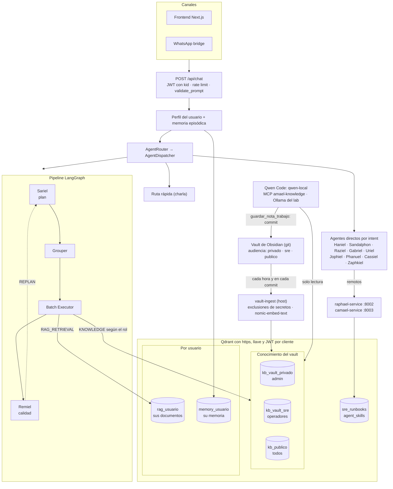
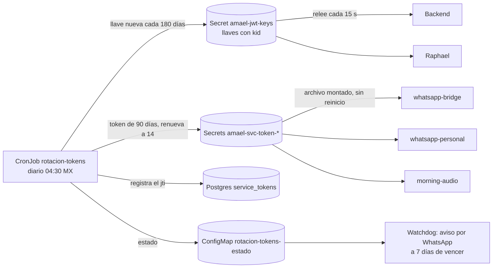

# Amael-AgenticIA

Plataforma multi-agente modular basada en LangGraph, FastAPI y Ollama para automatización inteligente. Corre como `amael-agentic-backend` en Kubernetes (MicroK8s, single-node, GPU RTX 5070), acompañada de los servicios standalone `raphael-service` (SRE) y `camael-service` (GitOps); el trader vive en su propio repo (`trader-service`).

**Versión actual:** `1.20.1` (raphael-service `1.1.51`) — el backend se despliega por el pipeline de CI (push a `main` = deploy).

---

## Arquitectura

El diagrama une el flujo de una petición con la capa de conocimiento: el vault de
Obsidian es la única fuente, Qdrant es su índice y cada consumidor lee solo lo que
su rol permite.



Roles en el paso `KNOWLEDGE`: `user` lee `kb_publico` y lo suyo; `operator` suma
`kb_vault_sre`; `admin` suma `kb_vault_privado`. El LLM nunca elige la colección.

La topología ya no se documenta a mano: se **deriva del código** y se sirve en
`GET /api/graph` — visible como grafo interactivo (estilo Obsidian) en
`/admin/graph`, con el tráfico real medido (`amael_agent_edge_total`) y la capa
de conocimiento (runbooks por tipo + colecciones Qdrant).

### Tiers de LLM (medido el 3-nov-2026)

| Servidor | Modelos | Rol |
|---|---|---|
| `ollama-service` (GPU) | `gemma4-uncensored-amael` (causal y visión, ruta normal y rápida; contexto 64K cargado, KV `q8_0`, 100 % GPU) · `qwen3.5:9b` (lo usa `qwen-local`) | interactivo |
| `ollama-cpu-service` | `qwen3:30b-a3b` (tier profundo) · `nomic-embed-text` (**embeddings de toda la plataforma**, `OLLAMA_EMBED_URL`) | trabajo nocturno + embeddings |

Regla de oro: **ningún cliente manda `num_ctx`** — el contexto efectivo es del
runner cargado, y un cliente divergente fuerza una recarga del modelo en cada
alternancia (la «ruleta del runner», 7-ago-2026).

---

## Agentes (14 registrados)

| Agente | Nombre | Rol |
|--------|--------|-----|
| `planner` | Sariel | Descompone requests en planes JSON (max 8 pasos) |
| `executor` | — | Ejecuta pasos: tools en paralelo, REASONING secuencial |
| `supervisor` | Remiel | Evalúa calidad 0–10, decide ACCEPT/REPLAN |
| `researcher` | Sandalphon | RAG por usuario (Qdrant) + DuckDuckGo |
| `productivity` | Haniel | Google Calendar / Gmail vía OAuth + Vault |
| `sre` | Raphael | Loop autónomo 60 s + skills procedurales aprobadas (standalone :8002) |
| `cto` | Raziel | Estrategia técnica |
| `dev` | Gabriel | Código, commits y PRs (GitHub) |
| `arch` | Uriel | Arquitectura y ADRs |
| `coder` | Jophiel | Generación/análisis de código en memoria |
| `devops` | Camael | GitOps: PR + RFC ServiceNow (standalone :8003) |
| `qa` | Phanuel | Ejecución de tests y reporte CI |
| `memory` | Zaphkiel | Memoria episódica + búsqueda de historial (`pg_trgm`, mensajes crudos) |
| `reminder` | Cassiel | **Scheduler conversacional** — «recuérdame X cada lunes» → `user_jobs` |

## El bucle de aprendizaje (plan Hermes, ago-2026)

```
conversación → Zaphkiel guarda episodios (cada turno)
      ↓ 03:30 · consolidador (tier profundo)
hechos estables («prefiere respuestas cortas») → inyectados COMPLETOS al prompt
```
```
incidente → runbook (N1) → consolidado con fusión (N3, 03:00)
      ↓ máx 2/noche
propuesta de SKILL.md → aprobación humana por WhatsApp (/sre skill approve)
      ↓
entra al diagnóstico de la siguiente anomalía (catálogo breve + cuerpo bajo demanda)
```

El gate de las skills es **estructural**: `skill_manage` solo puede proponer;
la activación existe únicamente en el comando humano.

---

## Conocimiento gobernado (RAG)

El vault de Obsidian se indexa en Qdrant por audiencia y cada consumidor lee solo
su capa. En producción desde el 1-nov-2026.

| Pieza | Dónde | Qué hace |
|---|---|---|
| Audiencia | frontmatter de cada nota | `privado` (por defecto), `sre` o `publico`. `personal/` y `trader/` siempre privadas; `inbox/` no se indexa |
| Ingesta | `knowledge/vault_ingest.py` en el host | Cron cada hora y hook post-commit. Bloquea el fragmento entero si trae un secreto (`knowledge/exclusiones.yaml`); sube solo lo que cambió y borra huérfanos |
| Paso `KNOWLEDGE` | planner + executor del backend | Colecciones según el rol; cada consulta queda en `knowledge_audit` |
| Documentos de usuario | `rag_<usuario>` | Lo que sube un usuario solo lo lee ese usuario; nunca llega a `kb_publico` |
| Qwen Code | `qwen-local` + `knowledge/mcp_server.py` | Perfil sin proveedores externos; token de solo lectura a `kb_*`; guarda notas en `qwen/<proyecto>/` del vault con commit local |

### Qwen Code (`qwen-local`)

`~/.local/bin/qwen-local` lanza Qwen Code con `QWEN_HOME=~/.qwen-local`: solo
existe el Ollama del lab, así que una nota privada no puede salir a un tercero. El
MCP `amael-knowledge` expone dos herramientas:

- `buscar_conocimiento(pregunta, ambito)`: embebe con `nomic-embed-text`, consulta
  Qdrant por https y reordena por similitud más coincidencia de palabras (umbral
  0.73). Devuelve `ruta:línea` y el fragmento; Qwen abre la nota con `read_file`.
- `guardar_nota_trabajo(texto, proyecto, tema)`: escribe la nota con
  `audiencia: privado`, hace `git pull` y commit local (nunca push). El hook la
  indexa y la siguiente sesión ya la encuentra.

---

## Seguridad: tokens de servicio y TLS

Los tokens de servicio vencen a los 90 días y se renuevan solos; Qdrant solo acepta
https. En producción desde el 2-nov-2026.



- La llave anterior se acepta 8 días más: las sesiones web no se cortan.
- Antes de emitir, el rotador espera a que cada pod del backend acepte la llave nueva.
- Revocar o forzar la rotación es un Job manual (comandos en [`CLAUDE.md`](./CLAUDE.md) § Security).
- TLS: cert-manager emite la CA `amael-ca` (10 años) y el certificado `qdrant-tls`
  (1 año, renovación automática). Los clientes confían en la CA con `QDRANT_CA_FILE`.

---

## SRE Agent — Raphael

Loop **Observe → Detect → Diagnose → Decide → Act → Report** cada 60 s, con
21 tipos de anomalía (cluster, Prometheus, tendencias, SLO, certificados, VRAM
del LLM), verificación post-acción a T+5 min, auto-rollback, postmortems LLM y
handoff GitOps a Camael. Watchdog externo independiente por si Raphael cae.
Detalle completo en [`CLAUDE.md`](./CLAUDE.md).

---

## Capacidades de plataforma

- **Scheduler conversacional**: `user_jobs` en Postgres, tick 60 s, claim con
  `FOR UPDATE SKIP LOCKED` (HPA corre 2 réplicas), entrega por WhatsApp.
- **Memoria destilada**: episodios → hechos (03:30, tier profundo); bloque de
  perfil con tope duro en código (900 chars), caché Redis invalidado por
  consolidación y GDPR-wipe.
- **Búsqueda de historial**: `pg_trgm` sobre `messages.content` — citas crudas
  con fecha y autor, ~0.1 s, 0 tokens.
- **DM pairing**: alta de números WhatsApp con códigos `AMAEL-XXXXXXXX` (1 h,
  canje atómico) — sin tocar ConfigMaps.
- **Ledger de entrega** (bridge 1.7.0): salientes persistidos en el PVC antes
  del send, reentrega al arrancar.
- **Multimedia**: transcripción (faster-whisper), visión (`qwen2.5vl:3b`), TTS
  (CosyVoice3 con voz clonada / Piper).

---

## Stack

| Capa | Tecnología |
|------|-----------|
| Orquestación | LangGraph StateGraph + AgentRegistry/SkillRegistry/ToolRegistry |
| LLM | Ollama — `gemma4-uncensored-amael` (GPU, KV q8_0) · `qwen3:30b-a3b` (CPU, profundo) · `nomic-embed-text` (CPU) |
| API | FastAPI |
| Storage | PostgreSQL · Redis · Qdrant · MinIO |
| Infra | MicroK8s · RTX 5070 · MetalLB · NGINX Ingress · cert-manager · Vault |
| Observabilidad | Prometheus · Grafana (12 dashboards) · OpenTelemetry · Tempo |
| CI/CD | GitHub Actions (self-hosted): Gitleaks · pip-audit · Checkov · Bandit · pytest/ruff · build → deploy → hook a Raphael |

---

## Despliegue

**El backend se despliega por CI**: push a `main` con la versión actualizada en
`k8s/agents/05-backend-deployment.yaml` → el pipeline construye, pushea el tag,
aplica el manifest y notifica a Raphael (monitoreo intensificado 10 min).

```bash
# 1. Subir la versión en el manifest (single source of truth)
#    k8s/agents/05-backend-deployment.yaml
# 2. Commit + push a main → CI hace build, push, deploy y verificación
git push origin main
gh run watch   # opcional
```

Raphael/Camael se construyen del mismo repo con build args
(`APP_MODULE`/`APP_PORT`, ver CLAUDE.md § Build) y se aplican con `kubectl` —
nunca `kubectl set image` sin actualizar el manifest primero.

---

## Qué está en cada repo

Amael vive en dos repos. **Amael-AgenticIA es el cerebro**: el backend, sus agentes y la
infraestructura que comparten. **Amael-IA son las herramientas que usa el cerebro**: los
canales por donde habla y los servicios que llama. Cada servicio tiene código y manifest en
el mismo repo (decisión D28a, 3-nov-2026).

| Repo | Qué tiene |
|---|---|
| **Amael-AgenticIA** (este) | Backend (`amael-agentic-backend`), Raphael, Camael, watchdog, rotación de tokens, conocimiento (`knowledge/`, `qwen-local`), day-planner, conversation-pruning; infraestructura compartida (`k8s/infrastructure/`: Postgres, Redis, Qdrant, MinIO, Ollama), ingress y RBAC |
| **[Amael-IA](https://github.com/ricardogs26/amael-ia)** | Frontend Next.js, whatsapp-bridge, whatsapp-personal, productivity, llm-adapter, piper, cosyvoice, morning-audio, english-coach, telegram-bot, imagen y manifest del github-runner |

Por qué son dos: en mar-2026 el backend se reescribió desde cero en este repo y Amael-IA se
quedó con los servicios de alrededor (commit `11362ba` de Amael-IA, 16-mar-2026).

---

## Documentación

- [`CLAUDE.md`](./CLAUDE.md) — arquitectura detallada, gotchas, workflows
- [`docs/ANALISIS-HERMES-VS-AMAEL.md`](./docs/ANALISIS-HERMES-VS-AMAEL.md) — el plan del bucle de aprendizaje
- [`docs/ANALISIS-INFRA-LLM.md`](./docs/ANALISIS-INFRA-LLM.md) — presupuesto de VRAM y tuning de Ollama
- [`runbooks/`](./runbooks/) — 18 runbooks estáticos + consolidados autogenerados en Qdrant
- [`k8s/`](./k8s/) — manifiestos (agents, infrastructure, ingress, config)
